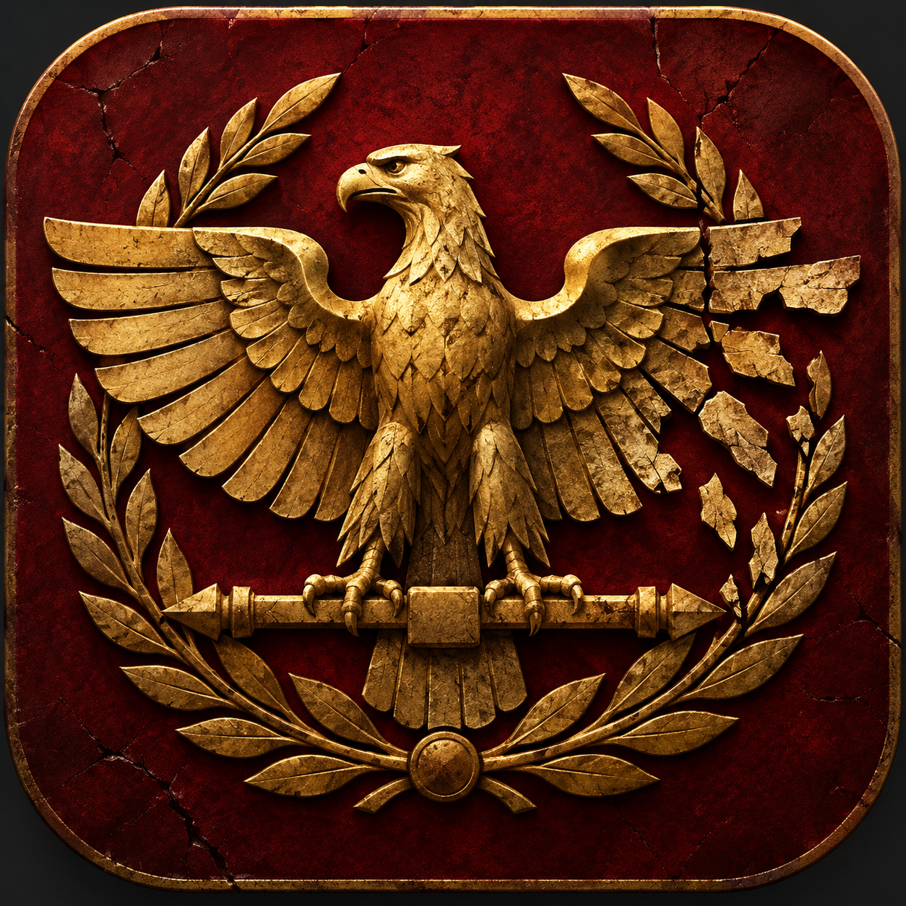

# Interregnum

<p align="center">
  
</p>

**Build a kingdom from the ruins of Rome.**

Interregnum is a single-player, turn-based historical strategy game set during the fragmentation of the Western Roman Empire. Its central idea is that conquering territory is easier than governing it: growth creates wealth and strategic depth, but also administrative cost, fragile loyalties, and instability.

This repository currently contains **Milestone 0**, the project foundation. It loads and validates a fictionalized Gaul scenario for 480 AD and presents its 12-province map in Godot. The turn simulation and player commands are deliberately reserved for Milestone 1.

## Project structure

```text
Interregnum.sln
src/
  Interregnum.Core/       Pure C# domain and scenario loading; no Godot dependency
  Interregnum.Game/       Godot 4.7.2 .NET application and scenario data
tests/
  Interregnum.Tests/      xUnit tests for portable core behavior
docs/                     Architecture, game design, and directional roadmap
```

## Prerequisites

- [.NET 10 SDK](https://dotnet.microsoft.com/download/dotnet/10.0) (the repository pins SDK 10.0.402)
- [Godot 4.7.2 .NET for Windows](https://godotengine.org/download/archive/4.7.2-stable/) — use the **.NET** build, not the standard build
- Git

Godot 4.7 documentation specifies support for .NET 8 and higher. The project targets .NET 10 as required and uses the current stable Godot 4 .NET maintenance release rather than a 4.8 preview.

## Build and test

From the repository root:

```powershell
dotnet restore Interregnum.sln
dotnet build Interregnum.sln --no-restore
dotnet test Interregnum.sln --no-build
```

Core-only development does not require Godot to be running, although restoring the solution downloads the Godot .NET SDK package.

A Windows GitHub Actions workflow runs the same restore, build, and test sequence. See the [foundation verification record](docs/foundation-verification.md) for the latest observed results and the outstanding Godot editor smoke test.

## Launch the game

Open `src/Interregnum.Game/project.godot` in the Godot 4.7.2 .NET editor and press **F6/F5**, or run:

```powershell
godot --path src/Interregnum.Game --editor
```

The executable name may be `Godot_v4.7.2-stable_mono_win64.exe` if the downloaded archive was not added to `PATH`.

## Current features

- Portable .NET 10 domain model for factions, provinces, settlements, armies, and world state.
- Strict, human-readable JSON scenario loading with actionable validation failures.
- Fictionalized Gaul, 480 AD scenario with three factions and 12 connected provinces.
- Stylized native Godot 2D map with faction colors, boundaries, province selection, and an inspection panel.
- xUnit coverage for loading, ownership, adjacency, and invalid scenario rejection.
- Deterministic build settings and no simulation randomness.

## Current limitations

- No turn progression, economy processing, command handlers, recruitment, movement, taxation controls, rebellion, save/load, AI, or victory conditions yet.
- Only the Roman polity is marked playable; this has no behavioral effect in Milestone 0.
- Geography and political boundaries are intentionally stylized.
- The UI uses native controls and generated polygons; no final art, accessibility pass, localization, or resolution matrix exists yet.

See [architecture](docs/architecture.md), [game design](docs/game-design.md), and the [roadmap](docs/roadmap.md) for scope and rationale.
